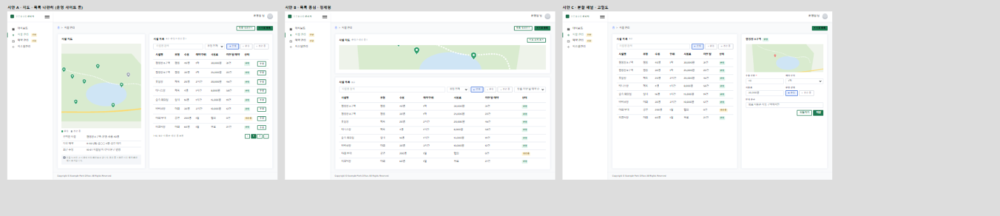
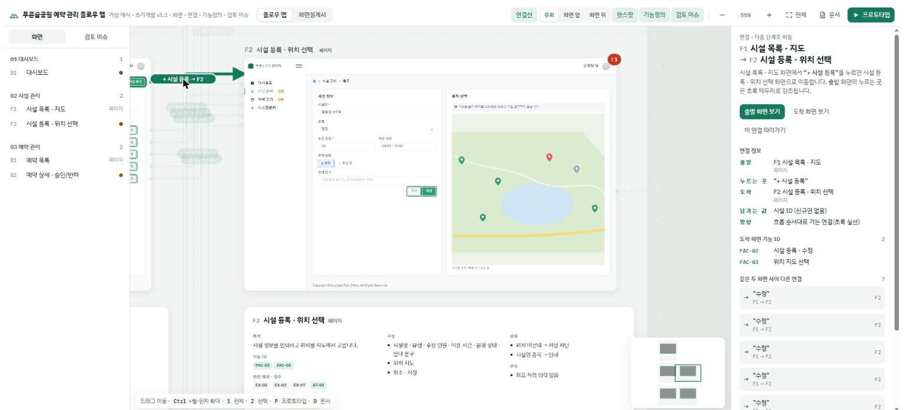
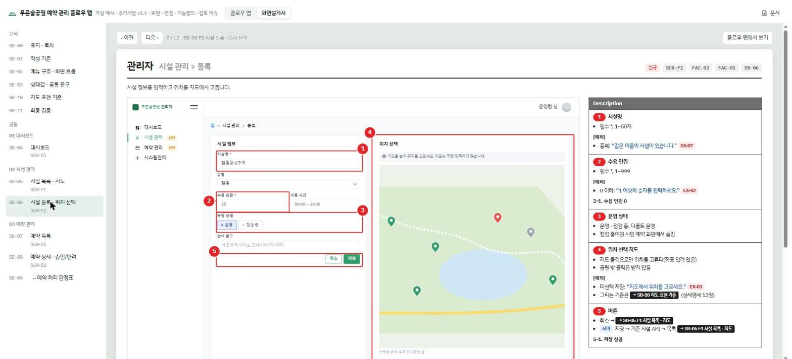

<div align="center">


# screen-spec-kit

<sub>플러그인 이름 <code>product_design_dongh</code> · 명령 <code>/product_design_dongh:start</code></sub>

**기획서 한 벌, 아이디어 한 줄이 화면설계서 · 플로우 맵 · 편집 가능한 디자인 캔버스 · 검수표가 되는 Claude Code 플러그인**

요청서 · 기획서 · 운영 사이트 · 아이디어를 읽고 메뉴 · 기능 · 컴포넌트 · 동작 · 연결까지 직접 분해한 뒤<br>
레퍼런스 조사와 시안 비교 → 화면 초안(Claude Design) → 개발 문서 → 플로우 맵 → 화면설계서(SB) → 디자인 시스템 → 자동 검수까지 만듭니다.

[](CHANGELOG.md)
[](https://code.claude.com/docs/en/plugins)
[](LICENSE)
[](https://github.com/dongdongdongdongding/product_design_dongh/actions/workflows/validate.yml)
[](https://github.com/dongdongdongdongding/product_design_dongh/stargazers)


<sub>가상 예시 <code>examples/demo-park</code>(도시공원 시설 예약 관리)로 만든 플로우 맵(이전 버전 화면).</sub>

</div>

---

## 왜 만들었나

관리자 시스템 추가 개발을 하면 같은 내용을 네 번 씁니다. 기능정의서에 한 번, 화면설계서(SB)에 한 번, 디자인 툴에 한 번, 검수표에 한 번. 그리고 넷이 조금씩 어긋납니다. 기능 ID가 SB에 없고, 예외 문구가 디자인과 다르고, 검수 시나리오에 빠진 예외가 생깁니다.

screen-spec-kit은 **원본은 Markdown 문서 3종 + 화면 시안 한 파일**로 두고 나머지를 전부 거기서 생성합니다. 그리고 생성물끼리 맞는지 스스로 검사합니다.

## 무엇이 다른가

- 🧭 **한 원본 → 네 가지 산출물** — 기능정의서 · 상세명세 · WBS(Markdown)와 `project.js`(화면 시안)를 넣으면 플로우 맵, 화면설계서, 문서 패널, Claude Design 보드가 같은 데이터로 나옵니다. 어긋날 곳이 없습니다.
- 🔴 **SB 번호 마커 자동 배치** — `mk('2', '수용 인원', …)`처럼 *글자*나 선택자로 요소를 가리키면 빨간 번호 원과 박스가 그 위치에 붙고, 원끼리 · 글자와 겹치지 않는 자리를 엔진이 고릅니다. 화면이 바뀌어도 좌표를 다시 찍을 필요가 없습니다.
- 🔀 **화면을 피해 가는 연결선** — 버튼의 `data-go="F2"`에서 연결선을 자동으로 뽑아 **우회 / 화면 앞 / 화면 뒤** 세 모드로 그립니다. 연결선을 누르면 출발 · 누르는 곳 · 도착 · 넘기는 값 · 도착 화면 기능 ID가 나옵니다.
- 📋 **국내 관리자 SB 문법** — 머리줄(관리자 · 화면 경로) → 화면(빨간 번호) → Description(구성 · 입력 규칙 · `[예외]` 문구 · 저장 위치) → 하위 상태 견본(2-1, 5-1) → 판정표. 공공 · SI 프로젝트에서 바로 쓰는 형식입니다.
- ✅ **요구사항 추적 최종 검증** — 원본 요구 → 기능 ID → 화면, 12.2 입력 필드 → 시안 라벨, 예외 → 검수 시나리오, 지도 명세 → 시안, 금지 표기, WBS 합계를 표로 판정합니다. 하나라도 빠지면 "확인 필요"로 뜹니다.
- 🗺️ **지도 화면 명세** — 지도 기본 설정 · 기호(카카오 객체 · 색 · 쌓임 순서) · 화면별 구성 · 그리기 규칙을 문서 13장에서 읽어 SB 지도 기준 페이지로 만듭니다.
- 🤖 **자동 검수** — 로컬 서버 + Claude in Chrome으로 SB 마커 잘림 · 겹침, 연결선의 화면 관통, 디자인 보드 잘림 · 빈 공간을 숫자로 보고합니다. "0건"이 될 때까지 고칩니다.
- 🧩 **아이디어도 끝까지 분해** — 한두 문장만 줘도 역할 → 메뉴 → 화면 → 기능 → 컴포넌트 · 동작 → 화면 연결 → 데이터 · 상태 · 권한 → 예외 → 기본 결정까지 키트가 해석합니다. "어떤 메뉴가 필요하세요?"라고 묻지 않습니다.
- 🎨 **디자인은 글이 아니라 시안으로** — 외부 레퍼런스를 찾아 핵심 화면 하나를 방향이 다른 시안 2~4개로 그려 Claude Design 캔버스에 나란히 올립니다. 고르거나 섞거나, 캔버스에서 직접 고치면 그 수정을 가져와 시안 · 문서 · SB에 반영합니다(`import_design.mjs`).
- 📐 **디자인 시스템 내장** — Apple HIG 원칙, 닐슨 휴리스틱 자체 점검, W3C 디자인 토큰(`design_tokens.py`: 색 정리 · CSS 변수 연결 · 대비 검사), 컴포넌트 × 상태 보드.
- 📏 **허접한 초안 금지** — 화면마다 실제 업무 데이터 · 필터 · 상태 · 규칙 · 예외가 있는지 `check_density.mjs`로 잽니다. 기준은 실무 납품 산출물을 잰 하한입니다.

## 쓰는 흐름 — 단계를 강제하지 않는 하나의 세션

플러그인을 설치하고 `/product_design_dongh:start`(또는 그냥 "시작")라고 하고 가진 것을 주면 됩니다. 아래는 순서가 아니라 **메뉴**입니다 — 원하는 것부터, 원하는 것만("SB만 다시", "시안만 다시", "분해만").

| 작업 | 키트가 하는 일 | 내가 하는 일 |
|---|---|---|
| 자료 읽기 | 기획서 · **요구사항 정의서** · 운영 사이트를 읽고 요구 목록 (원래 요구 ID 유지) | 자료 주기 (아이디어 한 줄도 됨) |
| 기획 분해 | 역할 · 메뉴 · 화면 · 기능 · 컴포넌트 · 동작 · 연결 · 데이터 · 권한 · 예외 · 기본 결정 | "확인 필요" 몇 개에 답 (기본안으로 먼저 진행) |
| 디자인 방향 | 레퍼런스 조사 → 핵심 화면 시안 2~4개를 **Claude Design 캔버스**에 | 고르기 · 섞기 · 캔버스에서 직접 고치기 |
| 초안 · 검토 | 기획 밀도를 갖춘 핵심 화면 2~4개 → 캔버스 + 플로우 맵, 휴리스틱 자체 점검 | 캔버스에서 고치거나 말로 피드백 |
| 전체 확장 | 나머지 화면 · 문서 3종 · 연결 | 범위 · 공수 결정 |
| SB · 디자인 시스템 | 화면설계서 탭, 토큰 · 컴포넌트 보드 | — |
| 검수 · 전달 | 문서 정합 · 밀도 · 자동 검수 0건 → 링크 · 파일 | 게시 여부 |

멈추는 곳은 사용자가 정해야 하는 세 가지뿐입니다: 분해의 확인 필요, 시안 고르기, 범위 · 공수 증가. **"알아서 끝까지"**라고 하면 이것도 기본안으로 진행하고 마지막에 한 번에 묻습니다. 응답마다 현황 한 줄과 다음 추천이 붙고, 기록은 `spec-kit/progress.md`에 남습니다(`/product_design_dongh:status`).

```text
나: 시작. 동네 체육관 예약 앱 — 시민이 예약하고 관리자가 승인하는 거.
키트: 기획 분해 — 역할 3 · 메뉴 5 · 화면 14 · 기능 31 · 예외 후보 46 · 연결 27 (research/기획분해.md)
      확인 필요 2개는 기본안으로 진행합니다: ① 반려 후 재신청 허용 ② 노쇼 3회면 예약 제한
      레퍼런스 7건을 찾아 예약 목록 화면을 시안 3개로 캔버스에 올렸습니다: <디자인 링크>
        A 표 중심 · B 달력 중심 · C 목록 + 오른쪽 상세 패널
나: B로, 표 밀도는 C. 캔버스에서 필터 위치도 옮겨 놨어.
키트: 캔버스 수정 1화면 가져옴(필터 순서) · B + C 밀도로 토큰 정리(대비 미달 0)
      초안 4화면: <디자인 링크> · <플로우 맵 링크> · 밀도 미달 0 · 휴리스틱 위반 5 → 고침 5
      현황 — 자료 ✓ · 분해 ✓ · 디자인 B+C · 초안 1회차 · 문서 · SB · 검수 —   다음 추천: 피드백 주시면 2회차
```

(위 대화는 흐름을 보여 주는 예입니다.)



<sub>시안 비교 보드(가상 예시 demo-park). 같은 화면을 A 지도 · 목록 나란히 / B 목록 중심 정제형 / C 분할 패널 고밀도로.</sub>

## 화면

| 화면 선택 → 인스펙터 | 연결선 클릭 → 연결 정보 |
|---|---|
|  |  |
| **화면설계서(SB) 페이지** | **최종 검증** |
|  |  |
| **SB 표지 · 목차** | **Claude Design 보드 (내보내기)** |
|  |  |

## 흐름

```
원본(요청서 · 기획서 HWP/PPT/PDF · 참고 SB · 배포 사이트 · 아이디어)
   │ source-intake      → 근거 노트 · 사이트에서 잰 디자인 값
   │ plan-decompose     → 기획 분해 (메뉴 · 화면 · 기능 · 컴포넌트 · 동작 · 연결 · 데이터 · 권한 · 예외)
   │ design-brief       → 레퍼런스 · 시안 비교(variants.js) · 브리프 · tokens.json
   ▼
docs/  기능정의서 · 상세명세 · WBS        (spec-docs · check_docs.py)
   ▼
spec-kit/  theme.css(--ds-* 토큰) · project.js(시안) · sb-pages.js(SB) · design-system/
   │ build_kit.py       → flowmap.html  (플로우 맵 + 화면설계서 + 문서 패널 + 최종 검증)
   │ export_design.mjs  → design/project/*.dc.html (시안 비교 · 화면 · DS 보드) → Claude Design 캔버스
   │ import_design.mjs  ← 캔버스에서 고친 보드 → design-import/ (빌드 · 내보내기가 우선 사용)
   ▼
artifact-qa (check_density · design_tokens check · audits/*.js · harness.html) → 0건 → 게시
```

## 설치

### Claude Code

```bash
# Claude Code 안에서 (2.1.275 이상)
/plugin install product_design_dongh --marketplace dongdongdongdongding/product_design_dongh

# 이전 버전
/plugin marketplace add dongdongdongdongding/product_design_dongh
/plugin install product_design_dongh@product_design_dongh
```

필요: Python 3.10+, Node 18+. 자동 검수에는 [Claude in Chrome](https://claude.com/chrome), 게시에는 Artifact 도구가 필요합니다.

### Codex

```bash
git clone https://github.com/dongdongdongdongding/product_design_dongh
python product_design_dongh/scripts/install_skills.py --codex     # → ~/.agents/skills/
```
Codex를 다시 시작한 뒤 `$screen-spec-kit` 또는 "기획서로 화면설계서 만들어줘"라고 합니다. 저장소 안에서 Codex를 열면 [`AGENTS.md`](AGENTS.md)가 같은 흐름을 안내합니다. 브라우저 검수 · Artifact 게시 대신 로컬 서버 주소와 파일로 결과를 보여 줍니다.

### claude.ai

`python scripts/install_skills.py --zip dist/`로 스킬별 zip을 만들어 설정 › 기능 › 스킬에 올립니다. 빌드 스크립트가 필요한 단계는 저장소 파일을 대화에 함께 첨부해 주세요.

## 빠른 시작

```text
/product_design_dongh:new     <작업 폴더> <요청서.hwp> <기획서.pptx> https://<배포 사이트>
/product_design_dongh:build   <작업 폴더>/spec-kit --design
/product_design_dongh:audit   <작업 폴더>/spec-kit
/product_design_dongh:publish <작업 폴더>/spec-kit
```

또는 그냥 이렇게 말하면 `screen-spec-kit` 스킬이 순서를 잡습니다.

> 이 기획서랑 운영 사이트 보고 화면설계서랑 플로우 맵 만들어줘

### 예시를 직접 빌드해 보기

```bash
git clone https://github.com/dongdongdongdongding/product_design_dongh && cd product_design_dongh
python scripts/check_docs.py --docs examples/demo-park/docs --screens D1,F1,F2,B1,B2,C1
node scripts/check_density.mjs examples/demo-park              # 기획 밀도 — 미달 0
python scripts/design_tokens.py check examples/demo-park       # 토큰 반영 · 대비
python scripts/build_kit.py examples/demo-park                 # → examples/demo-park/flowmap.html
node scripts/export_design.mjs examples/demo-park examples/demo-park/design-export   # 시안 3 · 화면 6 · DS 2 보드
python -m http.server 8768 --bind 127.0.0.1                     # http://127.0.0.1:8768/examples/demo-park/flowmap.html
# 시안 비교: http://127.0.0.1:8768/examples/demo-park/design-export/harness.html?boards=V-A,V-B,V-C
```

`file://`로 열면 일부 기능이 막히므로 로컬 서버로 엽니다.

## 구성

| 경로 | 내용 |
|---|---|
| `skills/screen-spec-kit` | 진입점: 작업 메뉴 · 첫 응답 · 품질 기준 · 질문 방식 · 도구 대체 |
| `skills/source-intake` | 자료 읽기: 기획서 · 요구사항 정의서 · 운영 사이트 측정 |
| `skills/plan-decompose` | 기획 분해: 아이디어 · 자료 → 역할 · 메뉴 · 화면 · 기능 · 컴포넌트 · 동작 · 연결 · 데이터 · 권한 · 예외 |
| `skills/design-brief` | 디자인 방향: 레퍼런스 → 시안 2~4개 비교 → 브리프 · 토큰 |
| `skills/design-system` | 레퍼런스 조사 · HIG · 휴리스틱 · 토큰 · 컴포넌트 · 기획 밀도 기준 |
| `skills/draft-review` | 초안 → 캔버스 · 말 피드백 반영 반복 → 전체 확장 |
| `skills/spec-docs` | 문서 3종 작성 · 대조, 빌드가 읽는 표 목록 |
| `skills/flowmap-artifact` | `project.js` 계약 · 시안 규칙 · 연결선 · 게시 |
| `skills/sb-screen-spec` | SB 문법(마커 · 토큰 · 하위 상태 · 판정표 · SBCONF) |
| `skills/design-canvas` | Claude Design 캔버스: 내보내기 · 게시 · 캔버스 수정 가져오기 · 컴포넌트화 |
| `skills/artifact-qa` | 로컬 서버 + Chrome 자동 검수, 결과 해석, 보고 형식 |
| `commands/` | `start` · `status` · `new` · `build` · `audit` · `publish` |
| `engine/` | 공통 엔진(template.html · sb-head.js · sb-tail.js · sb.css). 프로젝트마다 고치지 않습니다 |
| `scripts/` | `build_kit.py` · `build_flowmap.py`(문서 파서) · `check_docs.py` · `check_density.mjs` · `export_design.mjs` · `import_design.mjs` · `design_tokens.py` · `audits/` |
| `templates/project-starter/` | 새 프로젝트 틀(화면 3 · 문서 3종 뼈대) |
| `templates/intake/` | 진행 기록 · 자료 요청 목록 · 기획 분해 · 디자인 브리프 양식 |
| `templates/design/` · `templates/design-system/` | 시안 비교(variants.js) · 캔버스 점검(harness.html) · 토큰(tokens.json) · 컴포넌트(components.js) |
| `AGENTS.md` · `scripts/install_skills.py` | Codex 등 다른 에이전트용 안내와 스킬 설치 |
| `examples/demo-park/` | 끝까지 만든 가상 예시(화면 6 · 시안 3 · 기능 8 · 예외 15 · 검수 6 · 토큰 · 컴포넌트) |

## 엔진 계약 (요약)

| 파일 | 정의할 것 |
|---|---|
| `project.js` | `PROJECT` · `SHARE` · `H`(화면 ID → 시안 HTML) · `SCREENS` · `FLOWS` · `ISSUES` |
| `variants.js` · `design-system/` | (선택) `VARIANTS` 시안 비교 · `tokens.json` · `COMPONENTS` |
| `design-import/<ID>.html` | (자동) 캔버스에서 가져온 화면 — `H[ID]`보다 우선 |
| `sb-pages.js` | `SBCONF` + `pgDocs()` · `pg()` · `mk()` · `pgMap()` · `pgVerify()` |
| `theme.css` | `.scr` 아래 클래스. 이름은 유지하고 값만 배포 사이트에 맞춥니다 |
| `docs/*.md` | 표 머리행으로 읽습니다 → [`doc-tables.md`](skills/spec-docs/references/doc-tables.md) |

자세한 문법: [`project-contract.md`](skills/flowmap-artifact/references/project-contract.md) · [`mark-syntax.md`](skills/sb-screen-spec/references/mark-syntax.md)

## 원칙

- **기존 화면은 고치지 않고 확장을 문서화합니다.** 시안은 배포 사이트에서 잰 색 · 글꼴 · 간격으로 그립니다.
- **화면은 캡처가 아니라 HTML로 그립니다.** 그래서 마커 배치 · 라벨 대조 · 디자인 내보내기가 됩니다.
- **비밀번호 · 키는 다루지 않습니다.** 배포 사이트 로그인은 사용자가 직접 합니다.

## 버전

| 버전 | 내용 |
|---|---|
| 1.3.0 | 기획 분해 · 시안 비교(Claude Design) · 캔버스 수정 가져오기 · 디자인 시스템(HIG · 휴리스틱 · 토큰 · 컴포넌트) · 기획 밀도 검사 · 단계 강제 제거 |
| 1.2.0 | 안내 흐름: 시작 질문 · 디자인 질문 · 초안 검토 반복 · 진행 기록 · 자동 모드, Codex · claude.ai 지원 |
| 1.1.0 | 공개 버전. 문서 패널 문구를 `PROJECT.docs`로 분리, 기능 ID 접두어 제한 제거, 가상 예시 `demo-park` |
| 1.0.0 | 내부 버전. 엔진 · 프로젝트 분리, 스킬 7 · 명령 4 |

전체 내역은 [CHANGELOG.md](CHANGELOG.md).

## 기여

이슈와 PR 환영합니다. [CONTRIBUTING.md](CONTRIBUTING.md)를 먼저 읽어 주세요.

## 라이선스

[MIT](LICENSE) © dongdongdongdongding. 예시의 서비스 · 기관 · 인물은 모두 가상입니다.
